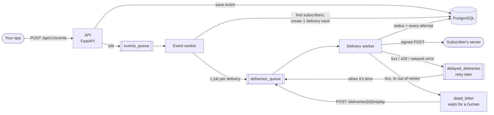

# Webhook Delivery Engine

A service that **reliably delivers events to other systems over HTTP** (webhooks).

Your app says *"an order was paid"* once. This engine finds everyone who subscribed to that event,
sends each of them a signed HTTP request, and keeps retrying if their server is down,
so your app never has to wait for them or care whether they're online.

**Stack:** Python · FastAPI · PostgreSQL · Redis · Docker Compose · Pytest

---

## How it works



The queues (`[[ ]]`) live in Redis. The API only saves and queues, then answers `202 Accepted`
straight away, and all the slow work happens in the two workers.

### A delivery's life

| What the subscriber's server answers | What happens |
|---|---|
| `2xx` | `success`, done. |
| `5xx`, `429`, or no answer at all | Temporary problem: retried later, up to 5 attempts in total. |
| Still failing after 5 attempts | `dead_letter`. |
| Any other `4xx` (e.g. `404` wrong URL) | Permanent problem, so it goes straight to `dead_letter` (retrying won't help). |

A `dead_letter` delivery can be sent again with one call once the subscriber has fixed their side.

---

## Features

- **Retries with exponential backoff + jitter**: waits up to 5s, 25s, 125s, 625s between attempts.
  The random part (jitter) stops thousands of retries from all hitting a recovered server in the same second.
- **Signed requests (HMAC-SHA256)**: every request carries
  `X-Signature-256: t=<timestamp>,v1=<signature>`, so subscribers can prove it came from us and wasn't changed.
  The timestamp lets them reject old requests that someone recorded and re-sent.
- **Per-domain rate limit**: at most 10 requests per second to the same domain, so we never flood one subscriber.
  A delivery that hits the limit just waits 2 seconds; it doesn't count as a failed attempt.
- **Dead-letter queue + replay**: nothing is silently dropped.
- **Full audit trail**: every attempt is stored with its status code and response body.

---

## Running it

You need [Docker Desktop](https://www.docker.com/products/docker-desktop/).

```bash
cp .env.example .env
docker compose up -d --build
docker compose exec api alembic upgrade head
```

Then open the interactive API docs: **http://localhost:8000/docs**

Watch the workers live:

```bash
docker compose logs -f event_worker delivery_worker
```

> The code is copied into the image, so after changing code run `docker compose up -d --build` again.

### Try it

1. Get a free test URL at [webhook.site](https://webhook.site) so you can watch requests arrive.
2. Subscribe to an event:

```bash
curl -X POST http://localhost:8000/api/v1/webhooks \
  -H "Content-Type: application/json" \
  -d '{"target_url": "https://webhook.site/<your-id>", "secret_key": "my-secret", "event_type": "order.paid"}'
```

3. Fire an event:

```bash
curl -X POST http://localhost:8000/api/v1/events \
  -H "Content-Type: application/json" \
  -d '{"event_type": "order.paid", "payload": {"order_id": 42, "amount": 10}}'
```

The request shows up on webhook.site within a second, with the `X-Signature-256` header.

### API

| Method | Path | What it does |
|---|---|---|
| `POST` | `/api/v1/webhooks` | Subscribe a URL to an event type. The secret is never sent back. |
| `POST` | `/api/v1/events` | Publish an event. Answers `202` right away; delivery happens in the background. |
| `POST` | `/api/v1/deliveries/{id}/replay` | Send a `dead_letter` delivery again. |

---

## Verifying a webhook (subscriber side)

```python
import hashlib, hmac, time

def verify(secret: str, header: str, body: bytes, max_age: int = 300) -> bool:
    parts = dict(p.split("=", 1) for p in header.split(","))
    timestamp, signature = parts["t"], parts["v1"]

    if abs(time.time() - int(timestamp)) > max_age:
        return False  # too old: possibly a recorded request being re-sent

    expected = hmac.new(secret.encode(), f"{timestamp}.".encode() + body, hashlib.sha256).hexdigest()
    return hmac.compare_digest(expected, signature)
```

Use the **raw request body** exactly as it arrived. Parsing the JSON and re-encoding it can change the bytes and break the check.

---

## Tests

The tests run inside the `api` container, against a separate test database and Redis DB 1,
so your real data is never touched. Subscriber servers are faked with
[respx](https://lundberg.github.io/respx/): no real internet, no real waiting for retry timers.

One-time setup, to create the test database:

```bash
docker compose exec db createdb -U postgres distribution_api_test
```

Run them:

```bash
docker compose exec -T api pytest
```

---

## Project layout

```
app/
  api/v1/endpoints/   HTTP endpoints (events, webhooks, deliveries)
  workers/            event_worker.py, delivery_worker.py
  core/               config, database, redis, signing, backoff, rate limiter
  models/             database tables
  schemas/            request/response shapes
alembic/              database migrations
tests/                pytest suite
```

---

## Known limitations

Honest list of what this version does **not** handle yet:

- If Redis is down when an event arrives, the event is saved but never queued.
- Running more than one delivery worker could send a retry twice.
- Retries give up after roughly 13 minutes at most. A subscriber that is down for an hour ends up in `dead_letter`.
- No endpoint yet to update or deactivate a webhook, and no authentication on the API itself.
